# Architecture

What exists in Azure and Cloudflare, and how the pieces connect. Every "why" lives in [plan.md](plan.md) — this file is the map, not the reasoning.

---

## System overview

Mail flows in from the left; pages and print go out to the right.

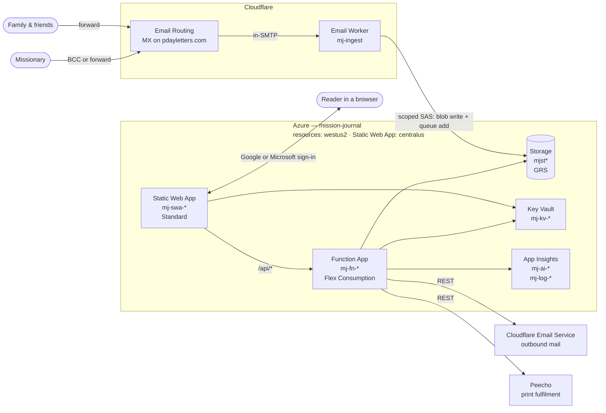

Details: [High-level architecture](plan.md#high-level-architecture) · [Azure resource plan](plan.md#azure-resource-plan) · [External constraints](plan.md#external-constraints)

---

## Ingest pipeline

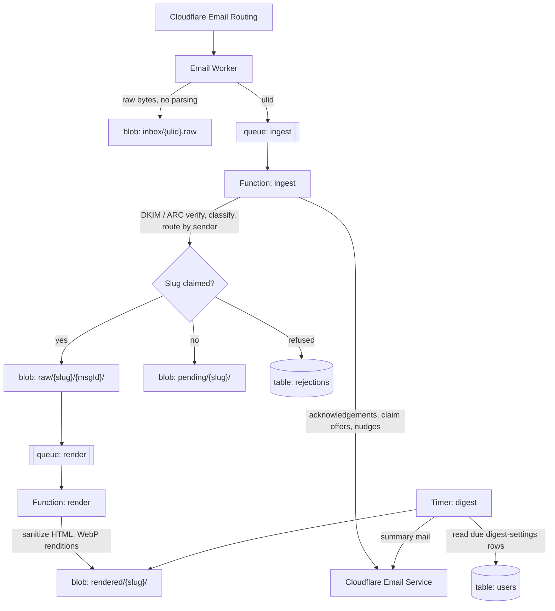

Details: [Email ingestion](plan.md#email-ingestion) · [Cloudflare Email Routing](plan.md#email-ingestion--cloudflare-email-routing) · [Missionary routing](plan.md#missionary-routing) · [Content sanitization](plan.md#content-sanitization) · [Photo handling](plan.md#photo-handling)

---

## Read path

Nothing in storage is public. Every byte a browser sees passes an ACL check first.

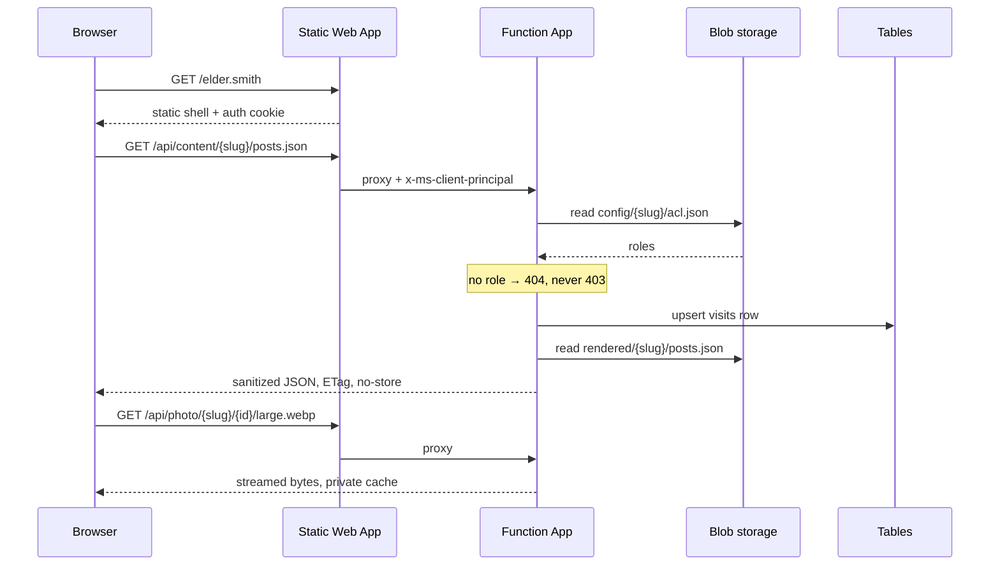

Details: [Private content delivery](plan.md#private-content-delivery) · [Access control](plan.md#access-control) · [Signing in and getting around](plan.md#signing-in-and-getting-around) · [Service operators](plan.md#service-operators)

---

## Blob containers

All private, no public access. One GRS account holds everything durable.

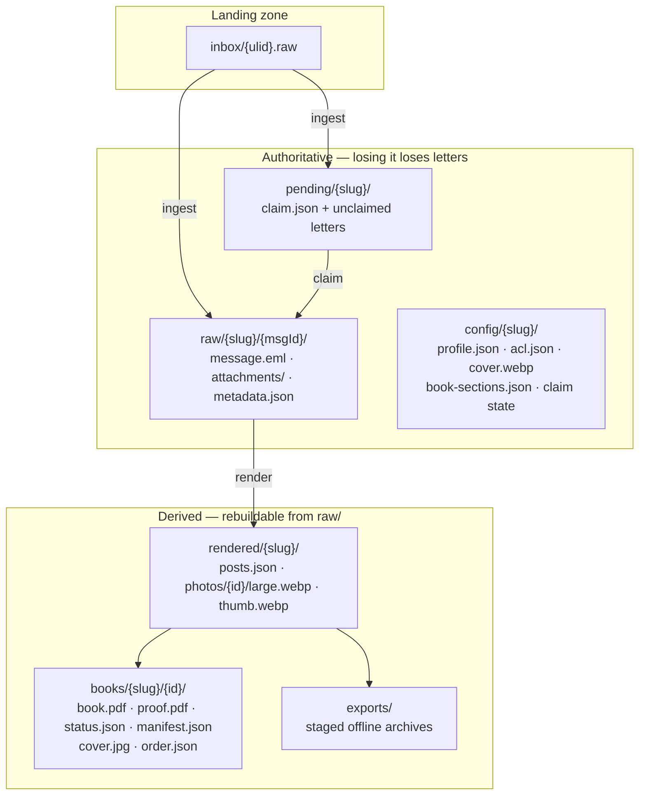

| Container | Lifecycle |
|---|---|
| `inbox` | deleted after 30 days, versions and snapshots too |
| `exports` | deleted after 7 days |
| `raw` | moved to Cold after 30 days |
| `raw`, `rendered`, `books` | superseded blob versions expire after 30 days |

`raw/` is never served to anyone and is not in the offline export — it exists for reprocessing and for authorship evidence.

Details: [Storage layout](plan.md#storage-layout) · [Data model](plan.md#data-model-postsjson-entry) · [Journal Publish](plan.md#journal-publish) · [Post-mission archive](plan.md#post-mission-archive)

---

## `config/{slug}/acl.json`

The source of truth for who may read a site. Checked on **every** content request; no table may override it.

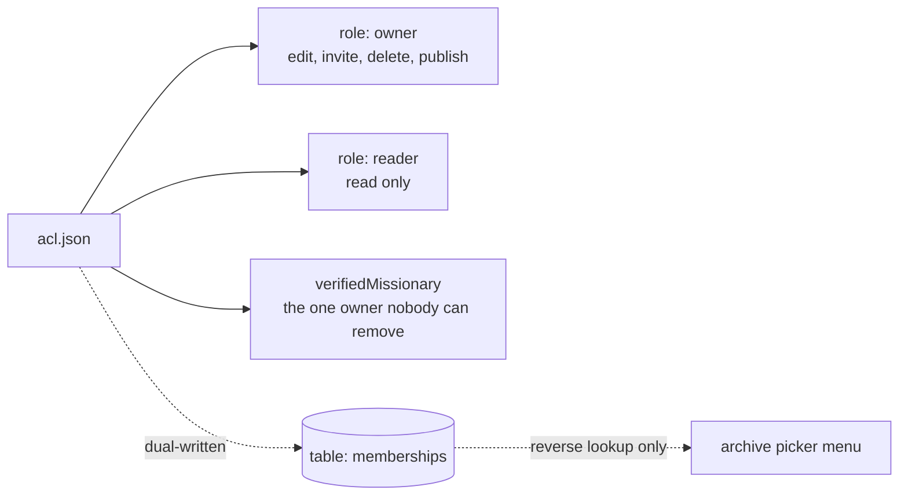

Details: [Access control](plan.md#access-control) · [Ownership and the 60-day window](plan.md#ownership-and-the-60-day-window)

---

## Tables

Fourteen physical tables share the same storage account.

<!-- Keep Mermaid entity rows limited to stored properties. Put authority, access patterns, and lifecycle in prose. -->

### User profiles

The `users` table holds two record types in each email partition. A `profile` row contains presentation-only name data copied from the sign-in provider. Verified email and `acl.json`, not these names, remain the identity and authorization inputs.

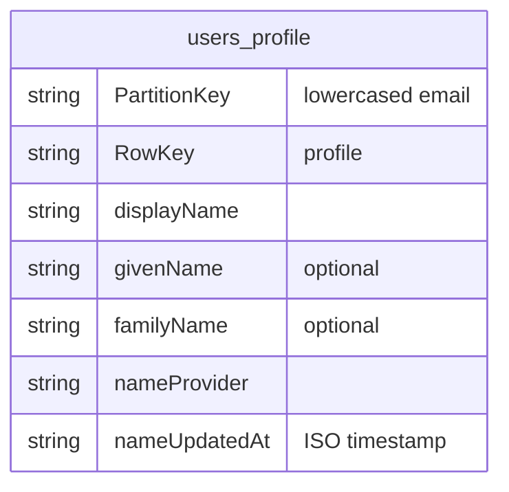

### Digest settings

The second `users` row type is `digest-settings`. Most reads are point reads by email; the daily digest timer scans the table and selects only rows with this `RowKey`.

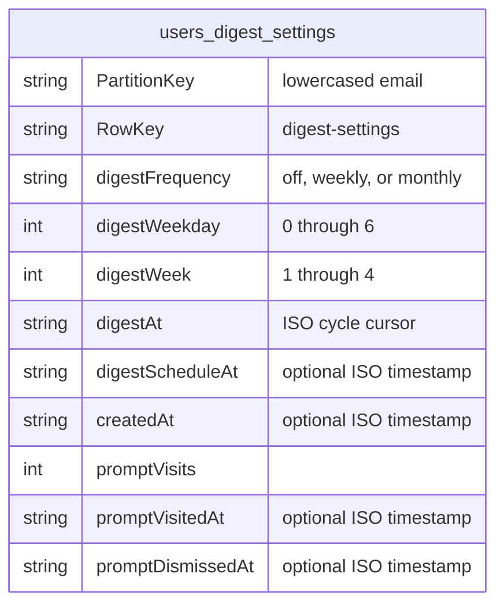

### Provider identity

This is a repairable index from a stable provider identity to the provider's current email address.

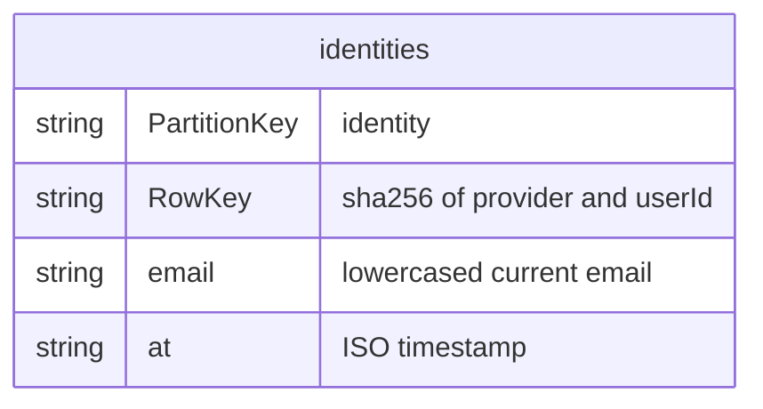

### Memberships and emailed invitations

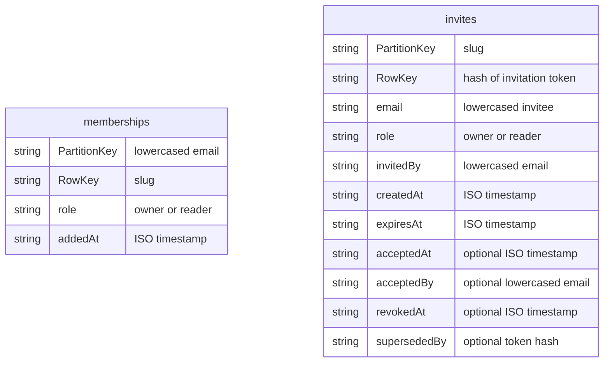

`memberships` is a derived reverse index from `acl.json` and never grants access. Invitation rows are retained as tombstones after acceptance or revocation so a spent token cannot become valid again.

### Quick Join

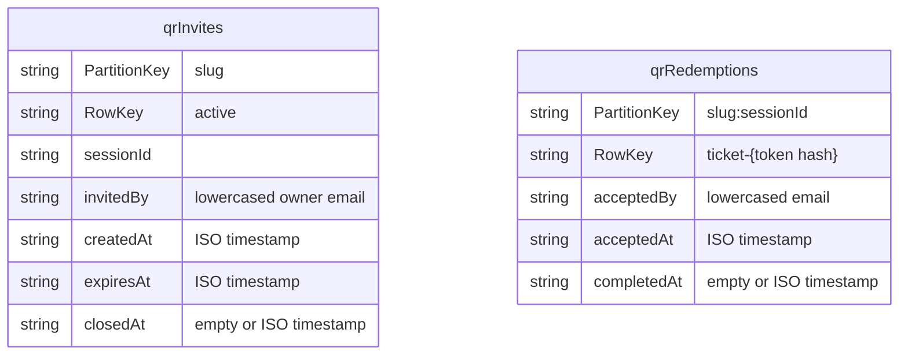

The displayed QR code is multi-use: every scan exchanges it for a new random ticket, so several people can scan the same code and join independently. A `qrRedemptions` row binds one browser's ticket to the first signed-in account that accepts it, lets that account retry safely, and prevents a copied ticket from adding a different account. After the owner closes Quick Join, the server rejects any later exchange attempt made from an old screenshot or a camera view still holding the code. Tickets issued before closure retain 20 seconds to finish sign-in.

### Archive metadata and reminders

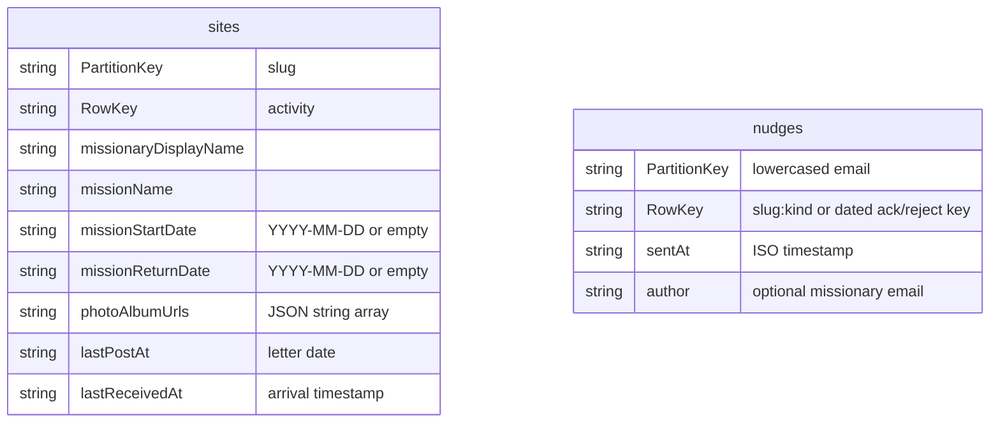

`nudges` rows are send-once locks. Most are permanent per recipient/archive/kind; acknowledgement and rejection keys include a UTC date.

### Mail consent and delivery

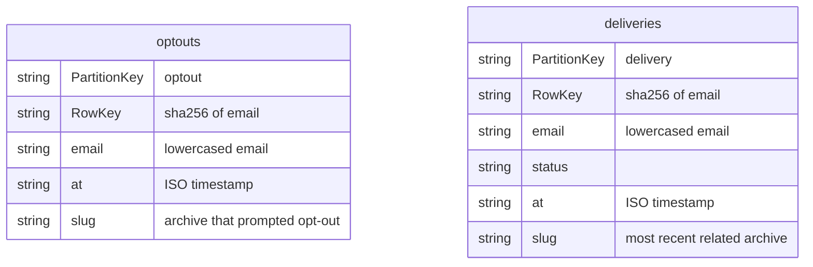

`optouts` is authoritative consent state. `deliveries` is a replaceable snapshot of the most recent Cloudflare delivery outcome.

### Intake guards

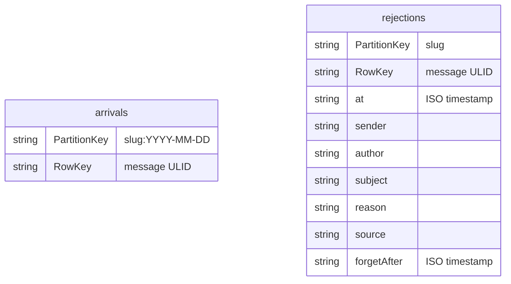

`arrivals` enforces the daily intake cap and is swept after 30 days. A `rejections` row is the only retained trace of a refused first letter and remains until `forgetAfter`.

### Activity and deletion lifecycle

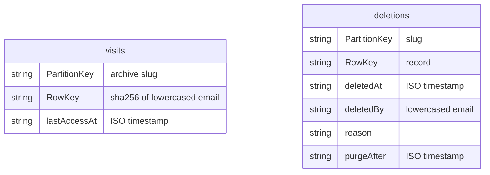

`visits` records the latest access for each person and archive. The email hash is a fixed Azure-safe key and limits casual disclosure; it is pseudonymous rather than anonymous because a known address can be hashed and matched. `deletions` is authoritative for the 30-day restoration and purge window.

### How the two `users` row types are written and read

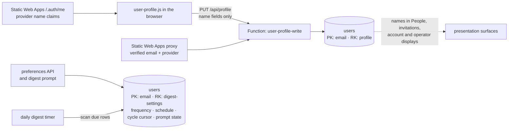

Details: [Storage layout](plan.md#storage-layout) · [Notification preferences](plan.md#notification-preferences) · [New-letter notifications](plan.md#new-letter-notifications) · [Onboarding and auto-provisioning](plan.md#onboarding-and-auto-provisioning)

---

## Queues and scheduled work

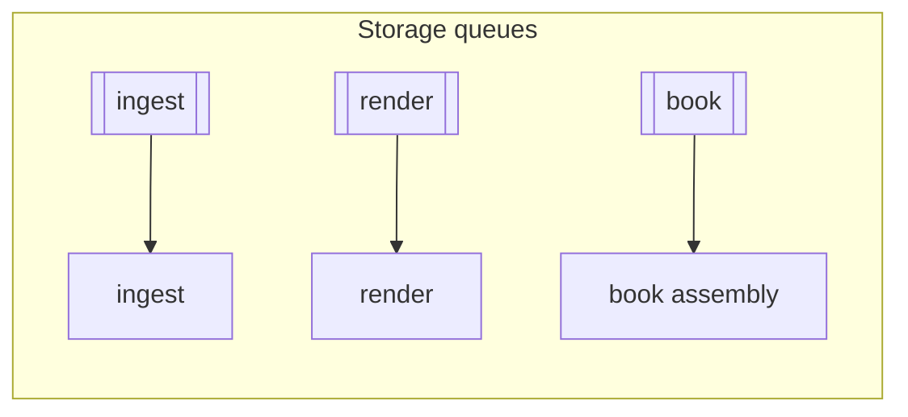

| Timer | UTC | What it does |
|---|---|---|
| `purge` | 03:15 | erase expired `pending/` sites |
| `remind` | 03:45 | tapering claim re-invitations |
| `sweep` | 03:45 | drop finished `arrivals` rows and normalize legacy daily `visits` rows |
| `erase` | 04:15 | erase archives past the 30-day deletion window |
| `digest` | 13:15 | new-letter digests |

Book assembly is its own queue: a render is one letter and takes a second, a book is a whole archive and takes minutes.

Details: [New-letter notifications](plan.md#new-letter-notifications) · [Journal Publish](plan.md#journal-publish) · [Onboarding and auto-provisioning](plan.md#onboarding-and-auto-provisioning)

---

## HTTP API

All routes are behind the Static Web App at `/api/*` and authorize inside the handler.

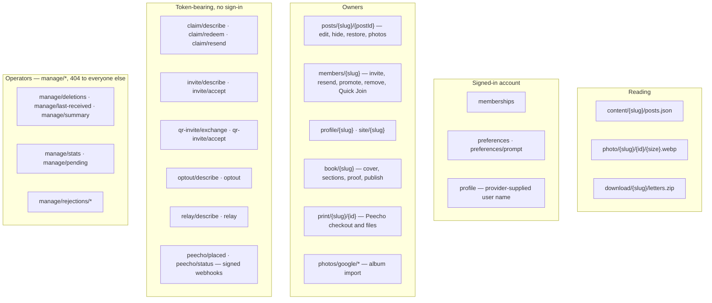

`admin/` is reserved by the Functions host, which is why operator routes are `manage/`.

Details: [Service operators](plan.md#service-operators) · [Editing and hiding posts](plan.md#editing-and-hiding-posts) · [Moderation / quarantine](plan.md#moderation--quarantine) · [The photo album](plan.md#the-photo-album) · [Adding pictures from Google Photos](plan.md#adding-pictures-from-google-photos)

---

## Identity and secrets

No storage connection string and no Azure credential is stored in this repository.

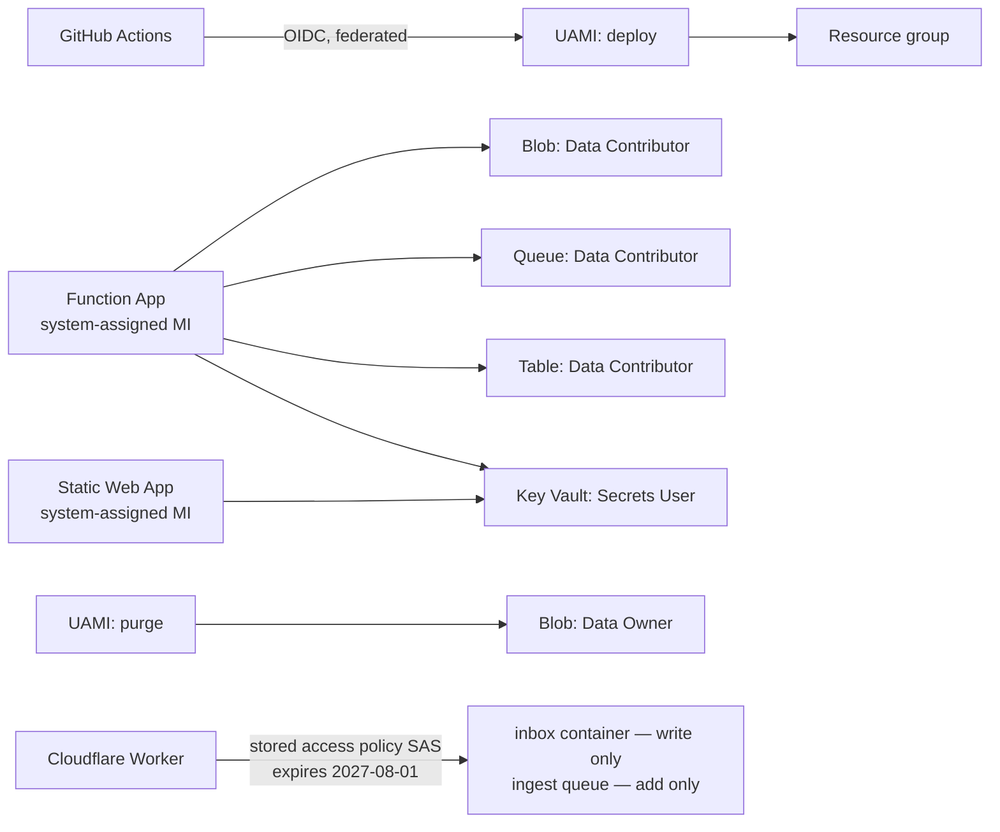

Key Vault holds the auth client secrets, the claim-token signing key, the Cloudflare API token, and the Peecho keys. A second storage account (`mjdep*`, LRS, Hot) holds only the deployment package — separated so versioning and GRS apply to letters and not to a zip republished daily.

Details: [Azure resource plan](plan.md#azure-resource-plan) · [External constraints](plan.md#external-constraints)

---

## Observability

App Insights is workspace-based on `mj-log-*` with a **1 GB/day ingest cap** and a scheduled-query alert on approach. Key Vault secret expiry raises Event Grid events to an action group. The Cloudflare Worker is the one component whose telemetry does not reach App Insights — Workers Logs is its only record.
